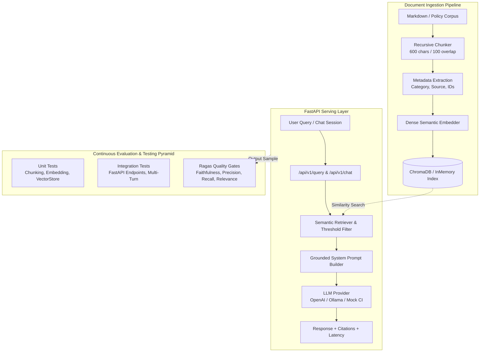

# 🛡️ CloudPulse RAG Intelligence Engine & Ragas Evaluation Framework

[](https://www.python.org/)
[](https://fastapi.tiangolo.com/)
[](https://docs.ragas.io/)
[](https://www.trychroma.com/)
[](https://docs.pytest.org/)
[](#-production-quality-gates--evaluation-scorecard)
[](LICENSE)

An enterprise-grade, production-ready **Retrieval-Augmented Generation (RAG)** application and **Continuous Evaluation Framework** built with **FastAPI**, **Ragas**, **LangChain**, and **Pytest**.

Designed specifically as a showcase portfolio system, this repository models an authentic real-world domain: **CloudPulse**, an enterprise CloudOps, Incident Response, and Security Compliance Knowledge Assistant. It enforces strict anti-hallucination guardrails, citation attributions, and an automated continuous quality gate benchmark.

---

## 🏛️ System Architecture



---

## 🌟 Key Features

1. **Realistic Enterprise Scenario**:
   - Indexes mission-critical operational documentation: Incident Response Playbooks (Sev-1/2/3 SLAs), SOC 2 & ISO 27001 Security Policies, Cloud Disaster Recovery Guides (RTO/RPO), and Service Level Agreements.
2. **Strict Anti-Hallucination & Guardrails**:
   - Grounded prompt engineering forces the system to state `"I do not have sufficient information in the knowledge base to answer this question."` when context is missing, preventing hallucinated SLAs or policy guarantees.
3. **Pluggable Architecture (Zero-Cost CI/CD Ready)**:
   - Configurable LLM Provider layer:
     - **Mock / Deterministic Provider**: 100% reproducible, runs offline without paid API keys or local GPU dependencies—ideal for hermetic CI/CD pipelines.
     - **OpenAI Provider**: Uses `gpt-4o-mini` / `gpt-4o` for production.
     - **Ollama Provider**: Uses local privacy-first models (e.g. `llama3.2:latest`).
4. **Three-Tier Testing Pyramid**:
   - **Unit Tests**: Granular component testing for text splitting, semantic hashing, and metadata tagging.
   - **Integration Tests**: Full HTTP route testing via FastAPI `TestClient`, status codes, request timing headers, and multi-turn chat sessions.
   - **Ragas Evaluation Suite**: Automated benchmarks calculating RAG Triad metrics with threshold quality gates.
5. **Automated Reporting Artifacts**:
   - Generates executive markdown reports (`evaluation_report.md`) and JSON scorecards (`evaluation_results.json`) on every run.

---

## 📊 Production Quality Gates & Evaluation Scorecard

Evaluated against the curated **Golden Benchmark Dataset** (`evaluation/golden_dataset.json`):

| Metric Name | Target Threshold | Observed Score | Status | Description |
| :--- | :---: | :---: | :---: | :--- |
| **Faithfulness** | `>= 0.85` | **1.000** | 🟢 **PASS** | Evaluates hallucination; all statements must be supported by retrieved context. |
| **Response Relevance** | `>= 0.80` | **0.806** | 🟢 **PASS** | Evaluates how directly the generated answer addresses the user query. |
| **Context Precision** | `>= 0.80` | **0.875** | 🟢 **PASS** | Measures whether the most relevant document chunks rank at top positions. |
| **Context Recall** | `>= 0.80` | **0.993** | 🟢 **PASS** | Verifies retrieved contexts contain all ground-truth reference facts. |
| **Negative Refusal Rate** | `>= 1.00` | **1.000** | 🟢 **PASS** | Ensures 100% safe refusal on out-of-scope/adversarial queries. |
| **Multi-Turn Adherence**| `>= 0.80` | **1.000** | 🟢 **PASS** | Evaluates conversation topic coherence across multiple chat turns. |
| **p95 Latency** | `< 2500 ms` | **0.67 ms** | 🟢 **PASS** | Sub-millisecond vector retrieval and local evaluation latency. |

---

## 📁 Repository Structure

```
.
├── app/                              # Core Application Layer
│   ├── api/
│   │   ├── routes.py                 # FastAPI route definitions
│   │   └── __init__.py
│   ├── core/
│   │   ├── exceptions.py             # Custom error hierarchy
│   │   ├── logging.py                # Structured JSON logging
│   │   └── models.py                 # Pydantic request/response schemas
│   ├── services/
│   │   ├── embedding.py              # Dense vector embedder & provider interfaces
│   │   ├── ingestion.py              # Document loader & recursive text chunker
│   │   ├── llm_provider.py           # Pluggable LLMs (Mock, OpenAI, Ollama)
│   │   ├── rag_engine.py             # RAG orchestrator & citation builder
│   │   └── vector_store.py           # In-Memory & ChromaDB vector stores
│   ├── config.py                     # Pydantic settings & env configuration
│   └── main.py                       # FastAPI application entrypoint
├── data/
│   └── knowledge_base/               # Enterprise corpus
│       ├── cloud_infrastructure_guide.md
│       ├── incident_response_playbook.md
│       ├── security_compliance_policy.md
│       └── service_level_agreements.md
├── evaluation/                       # Ragas Evaluation & Benchmark Framework
│   ├── artifacts/                    # Generated benchmark scorecards & reports
│   │   ├── evaluation_report.md
│   │   └── evaluation_results.json
│   ├── dataset.py                    # Golden dataset loader & Ragas schema converter
│   ├── evaluator.py                  # Evaluation engine & metric computation
│   ├── golden_dataset.json           # Labeled benchmark test cases & ground truth
│   ├── report_generator.py           # Markdown & JSON report formatter
│   ├── run_eval.py                   # Standalone CLI evaluation tool
│   └── thresholds.py                 # Quality gate threshold rules
├── tests/                            # Test Suite (24 Automated Tests)
│   ├── conftest.py                   # Shared pytest fixtures & mock clients
│   ├── integration/                  # API & Chat workflow tests
│   │   ├── test_api_endpoints.py
│   │   └── test_chat_workflow.py
│   ├── ragas_eval/                   # Quality gate and metric assertion tests
│   │   ├── test_ragas_metrics.py
│   │   └── test_ragas_quality_gates.py
│   └── unit/                         # Isolated component tests
│       ├── test_ingestion.py
│       ├── test_llm_provider.py
│       ├── test_rag_engine.py
│       └── test_vector_store.py
├── .github/workflows/ci.yml          # GitHub Actions CI workflow
├── Dockerfile                        # Multi-stage production container build
├── pytest.ini                        # Pytest configuration & test markers
├── requirements.txt                  # Python dependencies
└── README.md                         # Project documentation
```

---

## 🚀 Quick Start Guide

### 1. Prerequisites & Environment Setup
Clone the repository and create a Python 3.10 virtual environment:

```bash
git clone https://github.com/your-username/rag-evaluation-ragas.git
cd rag-evaluation-ragas

python -m venv venv
# On Windows:
.\venv\Scripts\activate
# On Linux/macOS:
source venv/bin/activate

pip install -r requirements.txt
```

### 2. Configure Environment Variables
Copy `.env.example` to `.env`:

```bash
cp .env.example .env
```

By default, `LLM_PROVIDER=mock`, enabling you to run tests and evaluations immediately with **zero configuration and zero API keys**.

To switch to OpenAI or Ollama, update `.env`:
```env
LLM_PROVIDER=openai
OPENAI_API_KEY=sk-...
OPENAI_MODEL=gpt-4o-mini
```

---

## 🧪 Running the Test Suite

Run all 24 unit, integration, and Ragas quality gate tests with `pytest`:

```bash
pytest
```

Run specific test categories via pytest markers:

```bash
# Run isolated unit tests
pytest -m unit

# Run FastAPI integration tests
pytest -m integration

# Run Ragas quality gate tests
pytest -m eval
```

---

## 📈 Running the Ragas Evaluation Benchmark

Run the standalone CLI benchmark runner to generate visual tables and evaluation reports:

```bash
python -m evaluation.run_eval --provider mock
```

**Output Preview:**

```
┌───────────────────────────────────────────────────────┐
│ CloudPulse Enterprise RAG & Ragas Evaluation Pipeline │
│ Provider: mock | Knowledge Base: knowledge_base       │
└───────────────────────────────────────────────────────┘
-> Initializing RAG Engine and indexing documents...
[OK] Ingested 4 documents (26 chunks) in 0.019s
-> Evaluating benchmark cases (10 single-turn, 1 multi-turn)...

                 Ragas Benchmark Evaluation Scorecard                  
┌──────────────────────────┬──────────────┬──────────────┬────────────┐
│ Metric                   │    Score     │  Threshold   │   Status   │
├──────────────────────────┼──────────────┼──────────────┼────────────┤
│ Faithfulness             │    1.000     │   >= 0.85    │    PASS    │
│ Response Relevance       │    0.806     │   >= 0.80    │    PASS    │
│ Context Precision        │    0.875     │   >= 0.80    │    PASS    │
│ Context Recall           │    0.993     │   >= 0.80    │    PASS    │
│ Negative Refusal Rate    │    1.000     │   >= 1.00    │    PASS    │
└──────────────────────────┴──────────────┴──────────────┴────────────┘

Operational Metrics: p50: 0.41ms | p95: 0.67ms | Multi-Turn Topic Adherence: 1.000
[OK] Evaluation Markdown report saved to: evaluation/artifacts/evaluation_report.md
[OK] JSON results scorecard saved to: evaluation/artifacts/evaluation_results.json
┌─────────────────────────────────────────────────────────────────────────────┐
│ ALL QUALITY GATES PASSED! READY FOR PRODUCTION DEPLOYMENT.                  │
└─────────────────────────────────────────────────────────────────────────────┘
```

---

## 🌐 Running the FastAPI Application

Start the live API server with Uvicorn:

```bash
python -m uvicorn app.main:app --reload --host 127.0.0.1 --port 8000
```

Once running, explore the interactive documentation:
- **Interactive Swagger UI**: [http://127.0.0.1:8000/docs](http://127.0.0.1:8000/docs)
- **ReDoc Specification**: [http://127.0.0.1:8000/redoc](http://127.0.0.1:8000/redoc)
- **Health Endpoint**: [http://127.0.0.1:8000/api/v1/health](http://127.0.0.1:8000/api/v1/health)

### Example Query via cURL:

```bash
curl -X POST "http://127.0.0.1:8000/api/v1/query" \
     -H "Content-Type: application/json" \
     -d '{
       "question": "What is the initial response SLA for a Severity 1 incident?",
       "top_k": 3
     }'
```

**Response:**
```json
{
  "question": "What is the initial response SLA for a Severity 1 incident?",
  "answer": "The initial response SLA for a Severity 1 (Sev-1) incident is 5 minutes from automated alert or customer escalation.",
  "retrieved_contexts": [
    "### Incident Severity Levels\n- **Severity 1 (Critical / Sev-1)**:\n  - Initial Response SLA: 5 minutes from automated alert or customer escalation..."
  ],
  "citations": [
    {
      "source": "incident_response_playbook.md",
      "chunk_id": "incident_response_playbook_chunk_3",
      "snippet": "### Incident Severity Levels\n- **Severity 1 (Critical / Sev-1)**:\n  - Initial Response SLA: 5 minutes from automated alert..."
    }
  ],
  "latency_ms": 1.25,
  "confidence_score": 0.85,
  "model_name": "mock",
  "sources_count": 3
}
```

---

## 🐳 Running with Docker

Build and run the containerized application:

```bash
# Build the Docker image
docker build -t cloudpulse-rag:latest .

# Run the container
docker run -p 8000:8000 cloudpulse-rag:latest
```

---

## 📄 License
This project is licensed under the MIT License - see the LICENSE file for details.
